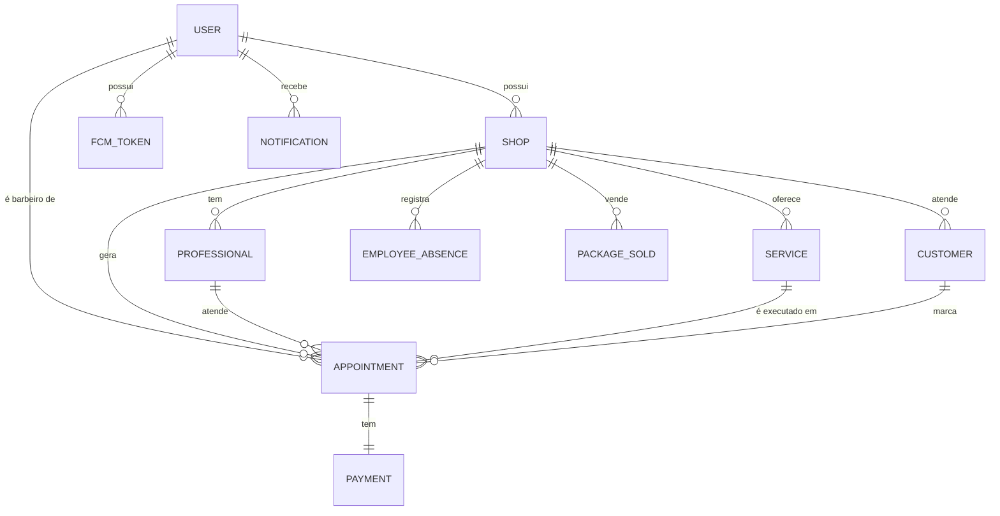

# ARQUITETURA_TECNICA.md — Arquitetura Técnica e Modelo de Dados Conceitual

**Versão:** 1.0  
**Data:** 2026-11-07  
**Autor:** Kilo Code (Orquestração: Aletheia v23)  
**Arquiteto:** Claude Code (Opus 5.5) — Comandante  
**Status:** Fase 0 — Spec Kit (especificação apenas, sem implementação)  
**Base:** IMPLEMENTATION-ROADMAP.md, SPEC.md, REQUISITOS_FUNCIONAIS_NAO_FUNCIONAIS.md

---

## 1. Visão Geral da Arquitetura

O Navio Barber 2.0 adota uma arquitetura monólito modular com separação clara entre frontend, backend e banco de dados. O foco do MVP é simplicidade, custo zero adicional e especificação-driven development (SDD).

**Decisões de arquitetura são propostas, não definitivas.** Requerem validação pelo Comandante antes da implementação.

---

## 2. Stack Tecnológica Proposta (MVP)

| Camada | Tecnologia | Justificativa |
|--------|-----------|---------------|
| **Frontend** | React 18 + Next.js 14 (App Router) | Stack já definida no roadmap; boa ecossistema; PWA pronta |
| **UI** | Tailwind CSS + shadcn/ui | Componentes prontos, responsivo, acessível |
| **Backend/API** | Node.js + tRPC | TypeScript end-to-end, tipos compartilhados, contract-first |
| **Banco de Dados** | PostgreSQL 16 + Prisma ORM | Relacional, ACID para transações de agendamento, Prisma para migrations |
| **Cache/Filas** | Redis 7 + BullMQ | Jobs assíncronos (no-show, notificações) |
| **Autenticação** | Better Auth | Simples, self-hosted, sem custo adicional |
| **Notificações** | Firebase FCM (Free Tier) | Único canal confirmado por evidência (D-03); gratuito para volumes iniciais |
| **Deploy** | Vercel (frontend) + Railway/Render (backend) | Free tiers disponíveis; sem custo inicial |
| **CI/CD** | GitHub Actions | Gratuito para repositórios públicos |
| **Armazenamento** | Supabase Storage / S3 (free tier) | Fotos de perfil, logo da barbearia |

**Custo adicional:** R$ 0,00 (todos os serviços têm free tiers adequados ao MVP).

---

## 3. Visão Arquitetural (C4 — Nível 1: Contexto)

```
┌─────────────────────────────────────────────────────────────┐
│                    USUÁRIO: BARBEIRO                        │
└──────────────────┬──────────────────────────────────────────┘
                   │ (navegador web / PWA)
                   ▼
┌─────────────────────────────────────────────────────────────┐
│              Frontend: Next.js 14 (App Router)              │
│  • Dashboard, Agenda, Clientes, Serviços, Configurações     │
│  • PWA com Service Worker                                   │
└──────────────────┬──────────────────────────────────────────┘
                   │ (tRPC over HTTP)
                   ▼
┌─────────────────────────────────────────────────────────────┐
│              Backend: Node.js + tRPC                        │
│  • Auth, Appointments, Customers, Services, Professionals   │
│  • Notifications (FCM), Payments (presencial), Reports      │
└──────────────────┬──────────────────────────────────────────┘
                   │ (Prisma ORM / SQL)
                   ▼
┌─────────────────────────────────────────────────────────────┐
│              Banco: PostgreSQL 16                           │
│  • Tabelas: users, shops, professionals, services,          │
│    customers, appointments, notifications, etc.             │
└─────────────────────────────────────────────────────────────┘
                   │ (FCM HTTP API)
                   ▼
┌─────────────────────────────────────────────────────────────┐
│              Firebase Cloud Messaging (FCM)                 │
│  • Push notifications para dispositivos                     │
└─────────────────────────────────────────────────────────────┘
```

---

## 4. Modelo de Dados Conceitual

### 4.1 Entidades Principais



### 4.2 Definição das Entidades

#### User (Barbeiro/Admin)

| Campo | Tipo | Obrigatório | Descrição |
|-------|------|-------------|-----------|
| id | UUID | Sim | Identificador único |
| email | String | Sim | Email de login |
| phone | String | Não | Telefone |
| password_hash | String | Sim | Senha hashada |
| name | String | Sim | Nome completo |
| role | Enum | Sim | "barber" \| "admin" |
| image_url | String | Não | Foto de perfil |
| created_at | Timestamp | Sim | Data de criação |
| updated_at | Timestamp | Sim | Data de atualização |

#### Shop (Barbearia/Estabelecimento)

| Campo | Tipo | Obrigatório | Descrição |
|-------|------|-------------|-----------|
| id | UUID | Sim | Identificador único |
| name | String | Sim | Nome da barbearia |
| address | String | Não | Endereço |
| phone | String | Não | Telefone |
| email | String | Não | Email |
| logo_url | String | Não | URL do logo |
| category | String | Não | Categoria/ramo |
| owner_id | UUID | Sim | Usuário proprietário |
| created_at | Timestamp | Sim | Data de criação |

#### Professional

| Campo | Tipo | Obrigatório | Descrição |
|-------|------|-------------|-----------|
| id | UUID | Sim | Identificador único |
| shop_id | UUID | Sim | Barbearia vinculada |
| user_id | UUID | Não | Usuário associado (se for barbeiro) |
| name | String | Sim | Nome do profissional |
| is_active | Boolean | Sim | Ativo/inativo |
| created_at | Timestamp | Sim | Data de criação |

#### Service

| Campo | Tipo | Obrigatório | Descrição |
|-------|------|-------------|-----------|
| id | UUID | Sim | Identificador único |
| shop_id | UUID | Sim | Barbearia vinculada |
| name | String | Sim | Nome do serviço |
| category | String | Não | Categoria do serviço |
| price | Decimal | Sim | Preço do serviço |
| duration_minutes | Int | Sim | Duração (mínimo 15) |
| commission_percent | Decimal | Não | Percentual de comissão |
| is_active | Boolean | Sim | Ativo/inativo |
| created_at | Timestamp | Sim | Data de criação |

#### Customer

| Campo | Tipo | Obrigatório | Descrição |
|-------|------|-------------|-----------|
| id | UUID | Sim | Identificador único |
| shop_id | UUID | Sim | Barbearia vinculada |
| full_name | String | Sim | Nome completo |
| phone | String | Sim | Telefone (único por shop) |
| email | String | Não | Email |
| birth_date | Date | Não | Data de nascimento |
| preferences | Text | Não | Preferências/observações |
| status | Enum | Sim | "new" \| "active" \| "inactive" \| "blocked" |
| no_show_count | Int | Sim | Contador de no-shows (padrão: 0) |
| created_at | Timestamp | Sim | Data de criação |
| updated_at | Timestamp | Sim | Data de atualização |

#### Appointment

| Campo | Tipo | Obrigatório | Descrição |
|-------|------|-------------|-----------|
| id | UUID | Sim | Identificador único |
| shop_id | UUID | Sim | Barbearia |
| professional_id | UUID | Sim | Profissional |
| service_id | UUID | Sim | Serviço |
| customer_id | UUID | Sim | Cliente |
| start_at | Timestamp | Sim | Início do atendimento |
| end_at | Timestamp | Sim | Fim do atendimento |
| status | Enum | Sim | "pending" \| "confirmed" \| "in_progress" \| "completed" \| "cancelled" \| "no_show" |
| total_value | Decimal | Sim | Valor total |
| payment_method | Enum | Não | "cash" \| "card" \| "pix" \| "voucher" |
| payment_status | Enum | Não | "pending" \| "paid" |
| notes | Text | Não | Observações |
| cancel_reason | Text | Não | Motivo do cancelamento |
| created_at | Timestamp | Sim | Data de criação |
| updated_at | Timestamp | Sim | Data de atualização |

#### FCMToken

| Campo | Tipo | Obrigatório | Descrição |
|-------|------|-------------|-----------|
| id | UUID | Sim | Identificador único |
| user_id | UUID | Sim | Usuário dono do token |
| token | String | Sim | Token FCM |
| device_type | Enum | Não | "ios" \| "android" \| "web" |
| is_active | Boolean | Sim | Token ativo |
| created_at | Timestamp | Sim | Data de criação |
| updated_at | Timestamp | Sim | Data de atualização |

#### Notification

| Campo | Tipo | Obrigatório | Descrição |
|-------|------|-------------|-----------|
| id | UUID | Sim | Identificador único |
| user_id | UUID | Sim | Usuário destinatário |
| title | String | Sim | Título |
| message | String | Sim | Mensagem |
| type_key | String | Sim | Tipo (new_appointment, cancellation, reschedule, reminder) |
| is_read | Boolean | Sim | Lida/não lida |
| created_at | Timestamp | Sim | Data de criação |

#### Payment

| Campo | Tipo | Obrigatório | Descrição |
|-------|------|-------------|-----------|
| id | UUID | Sim | Identificador único |
| appointment_id | UUID | Sim | Agendamento vinculado |
| amount | Decimal | Sim | Valor |
| method | Enum | Sim | "cash" \| "card" \| "pix" \| "voucher" |
| status | Enum | Sim | "pending" \| "paid" \| "refunded" |
| created_at | Timestamp | Sim | Data de criação |

#### EmployeeAbsence

| Campo | Tipo | Obrigatório | Descrição |
|-------|------|-------------|-----------|
| id | UUID | Sim | Identificador único |
| shop_id | UUID | Sim | Barbearia |
| professional_id | UUID | Sim | Profissional |
| start_date | Date | Sim | Início da ausência |
| end_date | Date | Sim | Fim da ausência |
| reason | String | Não | Motivo |
| created_at | Timestamp | Sim | Data de criação |

#### PackageSold

| Campo | Tipo | Obrigatório | Descrição |
|-------|------|-------------|-----------|
| id | UUID | Sim | Identificador único |
| shop_id | UUID | Sim | Barbearia |
| customer_id | UUID | Sim | Cliente |
| service_id | UUID | Sim | Serviço |
| quantity | Int | Sim | Quantidade |
| total_value | Decimal | Sim | Valor total |
| sold_at | Timestamp | Sim | Data da venda |

#### AppointmentAuditLog (Trilha de Auditoria)

| Campo | Tipo | Obrigatório | Descrição |
|-------|------|-------------|-----------|
| id | UUID | Sim | Identificador único |
| appointment_id | UUID | Sim | Agendamento |
| old_status | Enum | Não | Status anterior |
| new_status | Enum | Sim | Novo status |
| reason | String | Sim | Motivo da alteração |
| source | Enum | Sim | "system" \| "manual" |
| changed_by | UUID | Não | Usuário que alterou |
| changed_at | Timestamp | Sim | Data/hora da alteração |

---

## 5. Índices e Constraints

| Tabela | Índice/Constraint | Justificativa |
|--------|------------------|---------------|
| Customer | UNIQUE(shop_id, phone) | RG-CL-01: telefone único |
| Appointment | INDEX(shop_id, start_at) | Consulta de agendamentos por período |
| Appointment | INDEX(professional_id, start_at) | Disponibilidade por profissional |
| Appointment | INDEX(status) | Filtro por status |
| FCMToken | INDEX(user_id) | Busca de tokens por usuário |
| Notification | INDEX(user_id, is_read) | Listagem de notificações |
| AppointmentAuditLog | INDEX(appointment_id) | Trilha por agendamento |
| AppointmentAuditLog | INDEX(changed_at) | Auditoria por data |

---

## 6. Estratégia de Autenticação e Autorização

### 6.1 Autenticação

- **Método:** Email/telefone + senha (Better Auth)
- **Sessão:** JWT com expiração (24h), refresh token opcional
- **Hash de senha:** bcrypt com fator de custo 12
- **Multi-tenancy:** Usuário pertence a uma barbearia (shop_id)

### 6.2 Autorização (RBAC)

| Papel | Pode ver própria agenda | Pode ver configurações | Pode gerenciar profissionais | Pode ver relatórios |
|-------|------------------------|----------------------|----------------------------|-------------------|
| Barbeiro | ✅ | ❌ | ❌ | ❌ |
| Admin | ✅ | ✅ | ✅ | ✅ |

**Nota:** RBAC é INFERÊNCIA (não confirmado no HAR). Deve ser validado pelo Comandante.

---

## 7. Estratégia de Segurança e LGPD

### 7.1 Segurança

- Senhas hashadas (bcrypt)
- Tokens de sessão com expiração
- HTTPS obrigatório em produção
- CORS configurado para domínios autorizados
- Rate limiting em endpoints de autenticação

### 7.2 LGPD

- Consentimento para coleta de dados pessoais (tela de cadastro)
- Direito ao esquecimento: exclusão de dados do cliente sob solicitação
- Portabilidade: exportação de dados do cliente em formato estruturado
- Trilha de auditoria: AppointmentAuditLog registra alterações de status
- Documento `lgpd.md` deve ser criado e mantido (RF-EX-03, Fase 2+ para auditoria completa)

---

## 8. Estratégia de Notificações

- **Canal:** Firebase Cloud Messaging (FCM) — Free Tier
- **Eventos:** Novo agendamento, cancelamento, remarcação, lembrete
- **Dispositivos:** Registro de token FCM por usuário
- **Limitação:** Clientes sem app instalado ou que negaram permissão não recebem push
- **Alternativa para clientes sem push:** Documentada como limitação; fora do escopo inicial sem custo adicional

---

## 9. Diagrama de Componentes (Nível 2)

```
┌─────────────────────────────────────────────────────────────┐
│                      Next.js Frontend                       │
│  ┌──────────┐  ┌──────────┐  ┌──────────┐  ┌──────────┐   │
│  │ Dashboard│  │ Agenda   │  │ Clientes │  │ Config   │   │
│  └──────────┘  └──────────┘  └──────────┘  └──────────┘   │
└──────────────────┬──────────────────────────────────────────┘
                   │ tRPC Client
                   ▼
┌─────────────────────────────────────────────────────────────┐
│                    tRPC Router (Backend)                    │
│  ┌──────────┐  ┌──────────┐  ┌──────────┐  ┌──────────┐   │
│  │ auth     │  │ appmnt   │  │ customer │  │ service  │   │
│  │ shop     │  │ prof     │  │ notif    │  │ payment  │   │
│  └──────────┘  └──────────┘  └──────────┘  └──────────┘   │
└──────────────────┬──────────────────────────────────────────┘
                   │ Prisma Client
                   ▼
┌─────────────────────────────────────────────────────────────┐
│                    PostgreSQL 16                            │
│  • Tabelas de domínio + auditoria                           │
└──────────────────┬──────────────────────────────────────────┘
                   │
                   ▼
┌─────────────────────────────────────────────────────────────┐
│                    Redis + BullMQ                           │
│  • Jobs: no-show rotina, notificações assíncronas           │
└─────────────────────────────────────────────────────────────┘
                   │
                   ▼
┌─────────────────────────────────────────────────────────────┐
│                    Firebase FCM                             │
│  • Push notifications                                       │
└─────────────────────────────────────────────────────────────┘
```

---

## 10. Decisões de Arquitetura Pendentes

| ID | Decisão | Opções | Requer Aprovação |
|----|---------|--------|------------------|
| AD-01 | ORM | Prisma vs Drizzle vs Raw SQL | Sim |
| AD-02 | Auth provider | Better Auth vs Clerk vs Custom | Sim |
| AD-03 | Deploy frontend | Vercel vs Netlify vs Self-hosted | Sim |
| AD-04 | Deploy backend | Railway vs Render vs Self-hosted | Sim |
| AD-05 | RBAC implementação | Middleware vs Biblioteca CASL | Sim |

---

⚓ **Navio Barber 2.0 — Navegar com evidências, construir com precisão.**